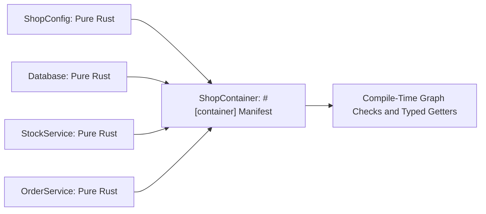

# Why Snapfit?

## What you want to do

The shop has four components — `ShopConfig`, `Database`, `StockService`, and `OrderService` — and you want to wire them together so that all four are shared singletons built in the right order, without polluting your domain code or scattering `Arc::clone` boilerplate across manual state structs.

## The code

Without `snapfit`, even a small four-component shop requires writing manual storage fields, manual initialization order, and manual `Arc::clone` factory methods. Notice that `build_order_service` builds a new `OrderService` on every call: nothing but reading it tells you so.

```example
name: ch01_manual_wiring
region: manual_assembly
```

Running the manual assembly prints:

```output
name: ch01_manual_wiring
```

With `snapfit`, the exact same pure domain structs are wired by declaring a single `#[container]` struct:

```example
name: ch01_why_snapfit
region: container
```

Running the `snapfit` container prints the exact same result:

```output
name: ch01_why_snapfit
```

## How it works



What the diagram shows:

1. `ShopConfig`, `Database`, `StockService`, and `OrderService` remain 100% pure Rust structs with zero macros or framework traits.
2. `ShopContainer` is the single place that declares the four singletons and how they connect.
3. At compile time, `#[container]` checks that every dependency exists and that none of them depend on each other in a cycle, works out the order in which `new()` builds the fields, each after the fields it needs, and generates strongly-typed getters (`get_config()`, `get_db()`, `get_stock()`, `get_orders()`).

### What makes `snapfit` unique

Most dependency injection tools in Rust force a choice between invasive annotations (`#[inject]` on every struct) or dynamic runtime type maps (`HashMap<TypeId, Box<dyn Any>>`). `snapfit` combines five properties that avoid both traps:

| Property | Traditional Component DI | Dynamic `TypeMap` Locators | `snapfit` |
| :--- | :--- | :--- | :--- |
| **Domain pollution** | Macros/traits on every service | Services or handlers pull from locator | **Zero** — domain structs are plain Rust |
| **Where the graph lives** | Scattered across dozens of files | Hidden inside runtime `.insert()` calls | **One central `#[container]` struct** |
| **Multiple instances of one type** | Requires qualifier macros on structs | Overwrites previous entry unless wrapped in newtypes | **Native** — edges name container fields (`deps = [read_db, write_db]`) |
| **Cycle & missing-dep detection** | Often requires a build script or fails at runtime | Panics or returns `None` at runtime | **Compile-time**, with the error on the offending field |
| **Resolution cost** | Vtable or generated factory | Hash lookup + `dyn Any` downcast | **Zero-cost** direct getters (`get_<name>()`) |

## Remember

1. Never add `snapfit` macros to domain services, repositories, or controllers — keep them plain Rust structs.
2. Put all dependency wiring in a `#[container]` struct so any developer or coding agent can read the entire architecture in one place.
3. Prerequisites in `deps = [...]` refer to field names on the container, not Rust type names.
