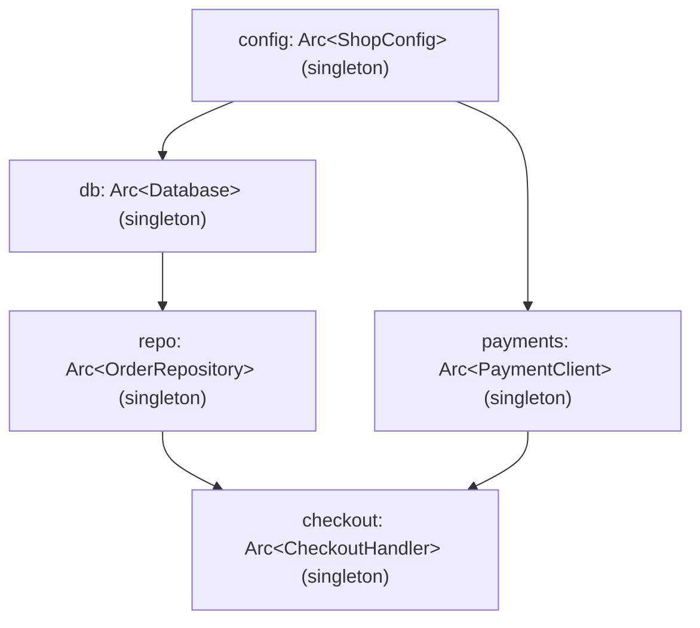

# Read the container, know the graph

## What you want to do

The shop has five components across three layers (`ShopConfig`, `Database`, `PaymentClient`, `OrderRepository`, and `CheckoutHandler`). You want to declare them in whatever order is most natural to read, such as top-down from the HTTP handler to the leaf configuration, and let `snapfit` build each one after the components it needs.

## The code

In `ShopContainer`, the fields are written top-down, starting with `checkout` (the entry point) and ending with `config` (the leaf singleton):

```example
name: ch03_container_graph
region: container
```

Instantiating `ShopContainer` and running a checkout works without manual ordering:

```example
name: ch03_container_graph
region: run
```

It prints:

```output
name: ch03_container_graph
```

## How it works



What the diagram shows:

1. `config` (`Arc<ShopConfig>`) is the only leaf: it needs nothing.
2. `db` (`Arc<Database>`) and `payments` (`Arc<PaymentClient>`) both need only `config`.
3. `repo` (`Arc<OrderRepository>`) needs `db`.
4. `checkout` (`Arc<CheckoutHandler>`) needs `repo` and `payments`, and receives clones of them in the exact order listed in `deps`.

### The order `ShopContainer::new()` builds them in

`snapfit` visits the fields in the order they are declared. Before it builds a field, it builds the fields that field needs, in the order its `deps` lists them, and the fields those need in turn:

1. `checkout` is declared first, but it needs `repo` and `payments`, so it waits.
2. `repo` needs `db`, and `db` needs `config`, so `config` is built first, then `db`, then `repo`.
3. `payments` needs only `config`, which is already built, so it is built next.
4. With `repo` and `payments` ready, `checkout` is built last.

The order is worked out at compile time, so it costs nothing when the program runs, and it is the same every time.

## Remember

1. You can declare the fields of a `#[container]` in any order: `snapfit` visits them in the order they are declared, and builds the fields each one needs before it.
2. Argument order inside `deps = [repo, payments]` **does** matter: it must match the parameter order of `CheckoutHandler::new(repo, payments)`.
3. Reading the `#[container]` struct alone tells you every component and its exact dependencies without opening a single implementation file.
