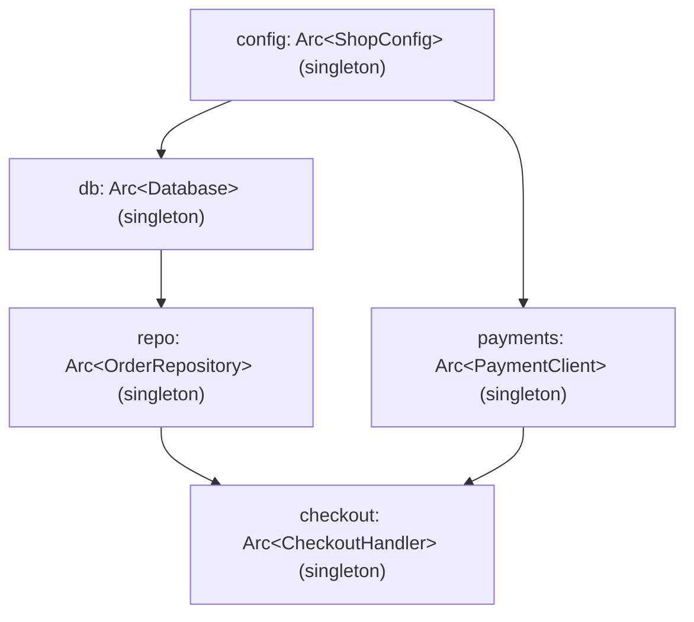

# Read the container, know the graph

## What you want to do

The shop has five components across three layers (`ShopConfig`, `Database`, `PaymentClient`, `OrderRepository`, and `CheckoutHandler`). You want to declare them in whatever order is most natural to read — such as top-down from the HTTP handler to the leaf configuration — and let `snapfit` figure out the valid initialization sequence at compile time.

## The code

In `ShopContainer`, the fields are written top-down, starting with `checkout` (the entry point) and ending with `config` (the leaf singleton):

```example
name: ch03_container_graph
region: container
```

Instantiating `ShopContainer` and running a checkout works without manual ordering:

```example
name: ch03_container_graph
region: run
```

It prints:

```output
name: ch03_container_graph
```

## How it works



What the diagram shows:

1. `config` (`Arc<ShopConfig>`) is the only leaf node with zero prerequisites, so the topological sort schedules it first during `ShopContainer::new()`.
2. `db` (`Arc<Database>`) and `payments` (`Arc<PaymentClient>`) both depend only on `config`, so they are initialized next.
3. `repo` (`Arc<OrderRepository>`) depends on `db`, so it is initialized after `db`.
4. `checkout` (`Arc<CheckoutHandler>`) is declared first but built last, because `#[singleton(deps = [repo, payments])]` needs both. It receives clones of `repo` and `payments` in the exact order listed in `deps`.

## Remember

1. Field order inside a `#[container]` struct does not affect initialization order — `snapfit` topologically sorts the dependency graph at compile time.
2. Argument order inside `deps = [repo, payments]` **does** matter: it must match the parameter order of `CheckoutHandler::new(repo, payments)`.
3. Reading the `#[container]` struct alone tells you every component, its lifecycle, and its exact dependencies without opening a single implementation file.
