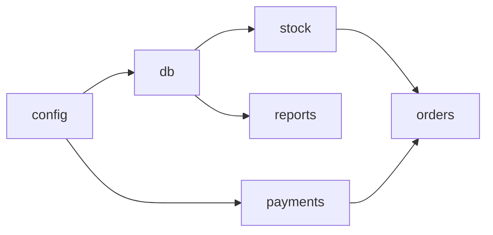

# Why we built Snapfit

## What you want to do

You want the services of [Chapter 3](03-who-builds-everything.md) exactly as they are, receiving their dependencies, and one place that builds them. But you want that place to work out the order itself, share every component, refuse mistakes when the program compiles, and show the whole graph to anyone who reads it.

## The code

The services are the ones from Chapter 3, with one change: the database and the Stripe client now read their settings from `ShopConfig` instead of taking them as literals. None of them mentions `snapfit`:

```example
name: ch04_why_snapfit
region: domain
```

The composition root is a struct. Each field is one component, and its attribute says what that component needs:

```example
name: ch04_why_snapfit
region: container
```

```example
name: ch04_why_snapfit
region: run
```

It prints:

```output
name: ch04_why_snapfit
```

## How it works



What the diagram shows:

1. `config` needs nothing, and both `db` and `payments` need it.
2. `stock` and `reports` both need `db`.
3. `orders` needs `stock` and `payments`.

Everything in the diagram is written in `ShopContainer`, and nowhere else.

### What `#[container]` does

1. **It writes the composition root for you.** From the struct, `#[container]` generates `ShopContainer::new()`, which calls each constructor once, passing it clones of the fields listed in its `deps`, and one `get_<field>()` getter per field.
2. **It works out the order.** `new()` builds every field after the fields it needs. You never order the lines yourself, so adding a dependency to `Database` is one name in one `deps` list.
3. **It shares everything it builds.** Every field is built once, and its getter returns a clone of it. For an `Arc` field, every clone points to the same value, which is why the program prints `true`. No component is quietly built again on each call.
4. **It checks the graph when the program compiles.** A name in `deps` that is not a field, or two fields that need each other, stop the build with an error at the field. [Chapter 11](11-mistakes-caught-by-the-compiler.md) shows each one.
5. **It names components by field, not by type.** `deps = [stock, payments]` names fields, so two fields of the same type, such as a read replica and a primary database, are two different components ([Chapter 9](09-multiple-instances-of-the-same-type.md)).
6. **It leaves the services alone.** `OrderService` asks for any `Arc<dyn PaymentGateway>`. Only the container says Stripe, by declaring `payments` as `Arc<StripeGateway>`; Rust converts it when `new()` passes it in ([Chapter 10](10-choosing-an-implementation.md)).
7. **It generates plain Rust.** `new()` is the code you would have written in `AppState::build`, and a getter is a field access and a clone. Nothing is looked up when the program runs.

### The problems, and where the book answers them

| Problem | How `snapfit` answers it | Where |
| :--- | :--- | :--- |
| The service picks its own dependencies | Services receive their dependencies; only the container names an implementation. | [Chapter 6](06-pure-domain-types.md), [Chapter 10](10-choosing-an-implementation.md) |
| It cannot be tested alone | A service is a plain struct: a test builds it with `new(...)` and fakes, without any container. | [Chapter 6](06-pure-domain-types.md) |
| Nothing is shared | Every field is built once and shared through its getter. | [Chapter 5](05-installing-and-first-singleton.md) |
| Two jobs in one place | A service knows only its own arguments; the container knows how everything is built. | [Chapter 7](07-wiring-dependencies-and-constructors.md) |
| Type parameters spread | The concrete type is named once, in a field's type, and services can take a trait object instead. | [Chapter 10](10-choosing-an-implementation.md) |
| The order is kept by hand | `new()` works out the order from `deps`. | [Chapter 8](08-read-the-container-know-the-graph.md) |
| Sharing is a convention | There is one kind of field: built once, shared. | [Chapter 5](05-installing-and-first-singleton.md) |
| The graph is nowhere | The container struct is the graph, in one place. | [Chapter 8](08-read-the-container-know-the-graph.md) |
| Mistakes appear at run time | Unknown names and cycles are compile errors. | [Chapter 11](11-mistakes-caught-by-the-compiler.md) |
| One entry per type | Components are named by field. | [Chapter 9](09-multiple-instances-of-the-same-type.md) |

### Why not the shapes of Chapter 3?

| Question | Building by hand | Service locator | `snapfit` |
| :--- | :--- | :--- | :--- |
| Where is the graph? | Spread over the constructor calls in `build` | In the `register` calls, at run time | In one struct |
| Who orders construction? | You | You, as you build what you register | `new()`, worked out when compiling |
| When is a missing dependency found? | When compiling | When the program asks for it | When compiling |
| Two components of one type? | Yes, two variables | No, one entry per type | Yes, two fields |
| What does a lookup cost? | A field access | A hash lookup and a downcast | A field access and a clone |
| Does the domain code change? | No | Only if services use the locator | No |

## Remember

1. `snapfit` is dependency injection where the composition root is a struct you write and a macro completes.
2. Services stay plain Rust: no attribute, trait or import of `snapfit` in them.
3. The container is the only place that names implementations, orders construction and shares components, and the compiler checks it.
