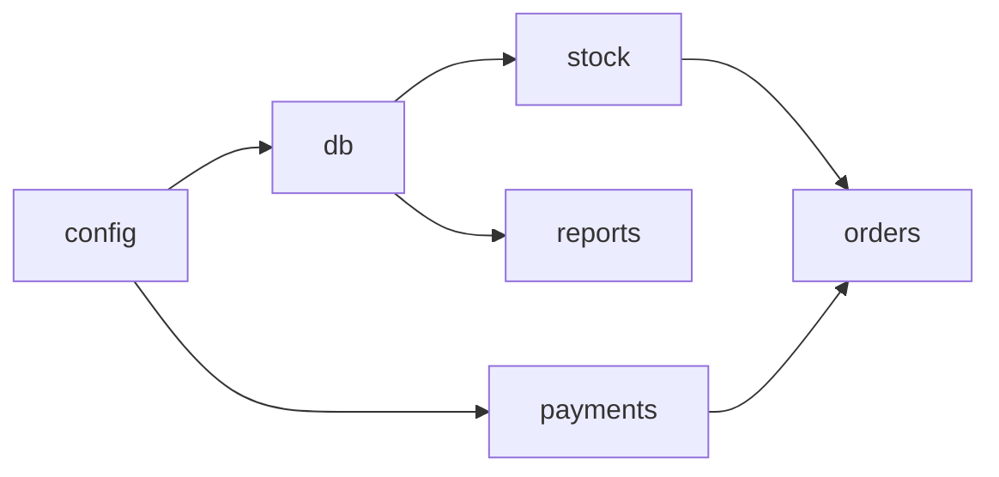

# Why we built Snapfit

Let's take stock of where we are. Our services from [Chapter 3](https://marlon-sousa.github.io/snapfit-rs/book/v0.1.1/03-who-builds-everything.md) are written the right way: each one receives what it needs. What we want now is a composition root that works out the order by itself, shares every component, refuses mistakes when the program compiles, and shows the whole graph to anyone who reads it.

That is what we built `snapfit` for. Instead of writing the composition root, you declare it, and a macro writes it for you.

## The same shop, declared

Here are the services again. There is one small change: the database and the Stripe client now read their settings from a `ShopConfig` instead of receiving them as text. Notice that none of them mentions `snapfit`:

Rust, from the program [`ch04_why_snapfit`](https://github.com/marlon-sousa/snapfit-rs/blob/v0.1.1/book/examples/ch04_why_snapfit.rs)

```rust
#[derive(Default)]
pub struct ShopConfig {
    pub database_url: &'static str,
    pub stripe_key: &'static str,
}

impl ShopConfig {
    pub fn new() -> Self {
        Self {
            database_url: "postgres://shop",
            stripe_key: "sk_live_shop",
        }
    }
}

pub struct Database {
    url: &'static str,
}

impl Database {
    pub fn open(config: Arc<ShopConfig>) -> Self {
        println!("opening a connection to {}", config.database_url);
        Self {
            url: config.database_url,
        }
    }
}

pub trait PaymentGateway {
    fn charge(&self, cents: u64) -> String;
}

pub struct StripeGateway;

impl StripeGateway {
    pub fn connect(config: Arc<ShopConfig>) -> Self {
        println!("connecting to Stripe with key {}", config.stripe_key);
        Self
    }
}

impl PaymentGateway for StripeGateway {
    fn charge(&self, cents: u64) -> String {
        format!("Stripe charged {cents} cents")
    }
}

pub struct StockService {
    db: Arc<Database>,
}

impl StockService {
    pub fn new(db: Arc<Database>) -> Self {
        Self { db }
    }

    pub fn reserve(&self, sku: &str) -> String {
        format!("reserved {sku} in {}", self.db.url)
    }
}

pub struct OrderService {
    stock: Arc<StockService>,
    payments: Arc<dyn PaymentGateway>,
}

impl OrderService {
    pub fn new(stock: Arc<StockService>, payments: Arc<dyn PaymentGateway>) -> Self {
        Self { stock, payments }
    }

    pub fn place_order(&self, sku: &str, cents: u64) -> String {
        format!(
            "{}; {}",
            self.stock.reserve(sku),
            self.payments.charge(cents)
        )
    }
}

pub struct ReportService {
    db: Arc<Database>,
}

impl ReportService {
    pub fn new(db: Arc<Database>) -> Self {
        Self { db }
    }

    pub fn daily_sales(&self) -> String {
        format!("sales report read from {}", self.db.url)
    }
}
```

And here is the composition root. It is a struct. Each field is one component, and the attribute above it says what that component needs:

Rust, from the program [`ch04_why_snapfit`](https://github.com/marlon-sousa/snapfit-rs/blob/v0.1.1/book/examples/ch04_why_snapfit.rs)

```rust
#[container]
pub struct ShopContainer {
    #[singleton]
    config: Arc<ShopConfig>,

    #[singleton(deps = [config], build = constructor(open))]
    db: Arc<Database>,

    #[singleton(deps = [config], build = constructor(connect))]
    payments: Arc<StripeGateway>,

    #[singleton(deps = [db])]
    stock: Arc<StockService>,

    #[singleton(deps = [stock, payments])]
    orders: Arc<OrderService>,

    #[singleton(deps = [db])]
    reports: Arc<ReportService>,
}
```

Read it like the ingredients list of a recipe: the database needs the configuration, the stock service needs the database, the order service needs the stock service and the payments. Let's run it:

Rust, from the program [`ch04_why_snapfit`](https://github.com/marlon-sousa/snapfit-rs/blob/v0.1.1/book/examples/ch04_why_snapfit.rs)

```rust
fn main() {
    let shop = ShopContainer::new();

    println!("{}", shop.get_orders().place_order("RUST-BOOK-01", 4500));
    println!("{}", shop.get_reports().daily_sales());
    println!(
        "the same order service every time: {}",
        Arc::ptr_eq(&shop.get_orders(), &shop.get_orders())
    );
}
```

It prints:

What `ch04_why_snapfit` prints, recorded in [`ch04_why_snapfit.txt`](https://github.com/marlon-sousa/snapfit-rs/blob/v0.1.1/book/expected/ch04_why_snapfit.txt)

```text
opening a connection to postgres://shop
connecting to Stripe with key sk_live_shop
reserved RUST-BOOK-01 in postgres://shop; Stripe charged 4500 cents
sales report read from postgres://shop
the same order service every time: true
```

One connection, one Stripe client, and the same order service every time we ask for it.

## The graph, in one place

Here is what `ShopContainer` declares, drawn as a picture:



What the diagram shows:

1. `config` needs nothing, and both `db` and `payments` need it.
2. `stock` and `reports` both need `db`.
3. `orders` needs `stock` and `payments`.

Everything in that picture is written in `ShopContainer`, and nowhere else.

## What the macro writes for us

`#[container]` reads the struct and writes the code we wrote by hand in `AppState`. Here is what it does, step by step:

1. **It writes the composition root.** It generates `ShopContainer::new()`, which calls each component's constructor once, passing it clones of the fields listed in its `deps`. It also generates one `get_<field>()` method per field, so you can ask for any component.
2. **It works out the order.** `new()` builds every field after the fields it needs. You never order the lines yourself, so when `Database` needs something new, you add one name to one `deps` list.
3. **It shares everything it builds.** Every field is built once, and its getter hands you a clone of it. For an `Arc` field, every clone points to the same value, which is why the program printed `true`. No component is quietly built again on each call.
4. **It checks the graph when the program compiles.** A name in `deps` that isn't a field, or two fields that need each other, stop the build with an error at the field. [Chapter 12](https://marlon-sousa.github.io/snapfit-rs/book/v0.1.1/12-mistakes-caught-by-the-compiler.md) shows each one.
5. **It names components by field, not by type.** `deps = [stock, payments]` names fields, so two fields of the same type, such as a read replica and a primary database, are two different components ([Chapter 9](https://marlon-sousa.github.io/snapfit-rs/book/v0.1.1/09-multiple-instances-of-the-same-type.md)). When both go to the same constructor, a factory or a builder hands them over by name ([Chapter 10](https://marlon-sousa.github.io/snapfit-rs/book/v0.1.1/10-passing-dependencies-by-name.md)).
6. **It leaves the services alone.** `OrderService` asks for any `Arc<dyn PaymentGateway>`. Only the container says Stripe, by declaring `payments` as `Arc<StripeGateway>`, and Rust converts it when `new()` passes it in ([Chapter 11](https://marlon-sousa.github.io/snapfit-rs/book/v0.1.1/11-choosing-an-implementation.md)). To switch providers, you change that field to another type that implements `PaymentGateway` and has a `connect` constructor taking the configuration. That is the whole change.
7. **It writes plain Rust.** `new()` is the code you would have written in `AppState::build`, and a getter is a field access and a clone. Nothing is looked up while the program runs.

## Why not build it by hand, or use a locator?

Here is how the three shapes we have seen compare:

| Question                            | Building by hand                             | Service locator                                 | `snapfit`                          |
| :---------------------------------- | :------------------------------------------- | :---------------------------------------------- | :--------------------------------- |
| Where is the graph?                 | Spread over the constructor calls in `build` | In the `register` calls, while the program runs | In one struct                      |
| Who orders construction?            | You                                          | You, as you build what you register             | `new()`, worked out when compiling |
| When is a missing dependency found? | When compiling                               | When the program asks for it                    | When compiling                     |
| Two components of one type?         | Yes, two variables                           | No, one entry per type                          | Yes, two fields                    |
| What does a lookup cost?            | A field access                               | A hash lookup and a downcast                    | A field access and a clone         |
| Does the domain code change?        | No                                           | Only if services use the locator                | No                                 |

## Which problem this solves

Every problem we found in Part 1, and the chapter where you can see how `snapfit` answers it:

| Problem                     | How `snapfit` answers it                                                                                            | Where                                                                                                                                                                                            |
| :-------------------------- | :------------------------------------------------------------------------------------------------------------------ | :----------------------------------------------------------------------------------------------------------------------------------------------------------------------------------------------- |
| Tight coupling              | Services receive their dependencies; only the container names an implementation.                                    | [Chapter 6](https://marlon-sousa.github.io/snapfit-rs/book/v0.1.1/06-pure-domain-types.md), [Chapter 11](https://marlon-sousa.github.io/snapfit-rs/book/v0.1.1/11-choosing-an-implementation.md) |
| Hard to test                | A service is a plain struct: a test builds it with `new(...)` and fakes, without any container.                     | [Chapter 6](https://marlon-sousa.github.io/snapfit-rs/book/v0.1.1/06-pure-domain-types.md)                                                                                                       |
| Duplicated resources        | Every field is built once; for an `Arc` field, every getter call returns the same value.                            | [Chapter 5](https://marlon-sousa.github.io/snapfit-rs/book/v0.1.1/05-installing-and-first-singleton.md)                                                                                          |
| Mixed responsibilities      | A service knows only its own arguments; the container knows how everything is built.                                | [Chapter 7](https://marlon-sousa.github.io/snapfit-rs/book/v0.1.1/07-wiring-dependencies-and-constructors.md)                                                                                    |
| A closed list               | A new implementation is a new type named in one field; no service changes.                                          | [Chapter 11](https://marlon-sousa.github.io/snapfit-rs/book/v0.1.1/11-choosing-an-implementation.md)                                                                                             |
| Spreading type parameters   | The concrete type is named once, in a field's type, and services can take a trait object instead.                   | [Chapter 11](https://marlon-sousa.github.io/snapfit-rs/book/v0.1.1/11-choosing-an-implementation.md)                                                                                             |
| Someone still has to choose | The container chooses, once, in the types of its fields.                                                            | [Chapter 11](https://marlon-sousa.github.io/snapfit-rs/book/v0.1.1/11-choosing-an-implementation.md)                                                                                             |
| Ordering by hand            | `new()` works out the order from `deps`.                                                                            | [Chapter 8](https://marlon-sousa.github.io/snapfit-rs/book/v0.1.1/08-read-the-container-know-the-graph.md)                                                                                       |
| Sharing by convention       | There is one kind of field: built once, when the container is built.                                                | [Chapter 5](https://marlon-sousa.github.io/snapfit-rs/book/v0.1.1/05-installing-and-first-singleton.md)                                                                                          |
| An invisible graph          | The container struct is the graph, in one place.                                                                    | [Chapter 8](https://marlon-sousa.github.io/snapfit-rs/book/v0.1.1/08-read-the-container-know-the-graph.md)                                                                                       |
| Arguments by position       | A factory receives its dependencies by name, and a builder takes them through setters named after them.             | [Chapter 10](https://marlon-sousa.github.io/snapfit-rs/book/v0.1.1/10-passing-dependencies-by-name.md)                                                                                           |
| Run-time failures           | Unknown names and cycles are compile errors.                                                                        | [Chapter 12](https://marlon-sousa.github.io/snapfit-rs/book/v0.1.1/12-mistakes-caught-by-the-compiler.md)                                                                                        |
| One entry per type          | Components are named by field.                                                                                      | [Chapter 9](https://marlon-sousa.github.io/snapfit-rs/book/v0.1.1/09-multiple-instances-of-the-same-type.md)                                                                                     |
| Hidden dependencies         | Services never see the container, so they can't ask it for anything; each constructor lists what its service needs. | [Chapter 6](https://marlon-sousa.github.io/snapfit-rs/book/v0.1.1/06-pure-domain-types.md), [Chapter 13](https://marlon-sousa.github.io/snapfit-rs/book/v0.1.1/13-working-with-coding-agents.md) |

## Remember

1. `snapfit` is dependency injection where the composition root is a struct you write and a macro completes.
2. Services stay plain Rust: no attribute, trait or import of `snapfit` in them.
3. The container is the only place that names implementations, orders construction and shares components, and the compiler checks it.
