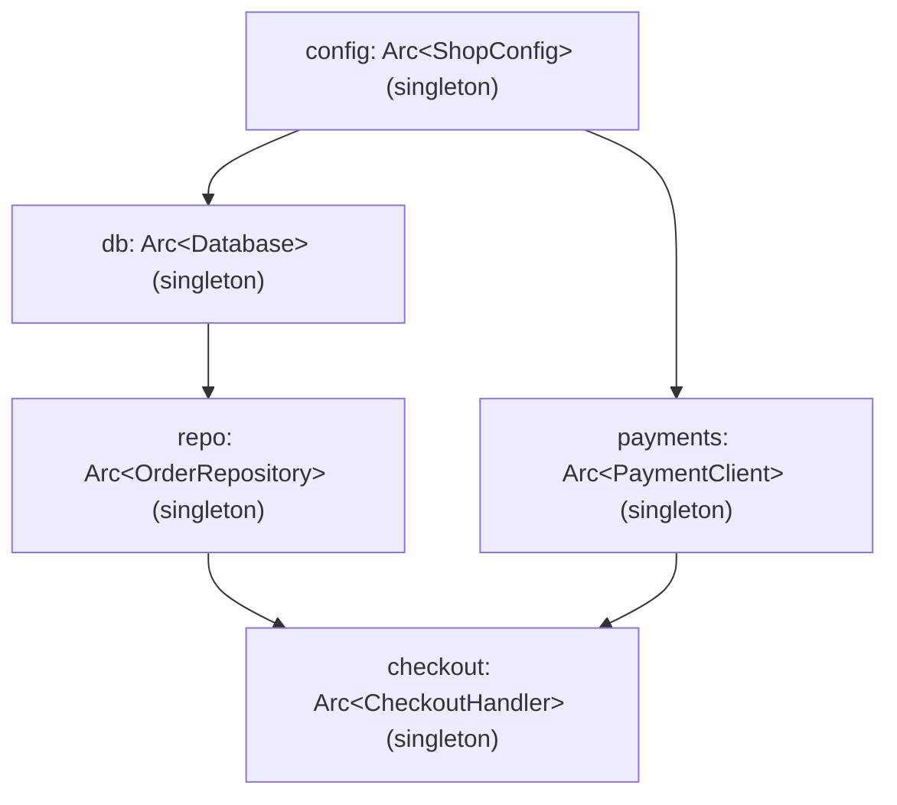

# Read the container, know the graph

When you open a new codebase, one of the first things you want to know is how it fits together: what talks to what, and what needs what. In a `snapfit` application, that answer is written in one struct. Let's see how much one container tells you, and why you can write its fields in whatever order reads best.

## Five components, written top-down

Our checkout now has five components across four layers: a configuration, a database and a payment client, an order repository, and the checkout handler at the top. We write the container the way you would explain it to a colleague, starting from the entry point and ending with the configuration:

Rust, from the program [`ch08_container_graph`](https://github.com/marlon-sousa/snapfit-rs/blob/v0.3.0/book/examples/ch08_container_graph.rs)

```rust
#[container]
pub struct ShopContainer {
    #[singleton(deps = [repo, payments])]
    checkout: Arc<CheckoutHandler>,

    #[singleton(deps = [db])]
    repo: Arc<OrderRepository>,

    #[singleton(deps = [config])]
    payments: Arc<PaymentClient>,

    #[singleton(deps = [config])]
    db: Arc<Database>,

    #[singleton]
    config: Arc<ShopConfig>,
}
```

That's the opposite of the order they have to be built in. Let's run it anyway:

Rust, from the program [`ch08_container_graph`](https://github.com/marlon-sousa/snapfit-rs/blob/v0.3.0/book/examples/ch08_container_graph.rs)

```rust
fn main() {
    let container = ShopContainer::new();
    let checkout = container.get_checkout();
    println!("{}", checkout.handle(1042, 2999));
}
```

It prints:

What `ch08_container_graph` prints, recorded in [`ch08_container_graph.txt`](https://github.com/marlon-sousa/snapfit-rs/blob/v0.3.0/book/expected/ch08_container_graph.txt)

```text
charged 2999 cents in eu-west | saved order #1042 in eu-west
```

It just works. Think of a recipe whose steps each say what they need. You can write the steps in any order: the baking step says it needs the batter, so the batter is mixed first.

## The graph, read from the struct

Here is everything the container says, drawn as a picture:



What the diagram shows:

1. `config` (`Arc<ShopConfig>`) needs nothing.
2. `db` (`Arc<Database>`) and `payments` (`Arc<PaymentClient>`) both need only `config`.
3. `repo` (`Arc<OrderRepository>`) needs `db`.
4. `checkout` (`Arc<CheckoutHandler>`) needs `repo` and `payments`, and receives them in the order its `deps` lists them.

You didn't have to open a single service to draw that. Everything came from `ShopContainer`.

## How the container finds the order

`snapfit` visits the fields in the order you declared them. Before it builds a field, it builds the fields that one needs, in the order its `deps` lists them, and the fields those need in turn. Let's follow it:

1. `checkout` comes first, but it needs `repo` and `payments`, so it waits.
2. `repo` needs `db`, and `db` needs `config`. So `config` is built first, then `db`, then `repo`.
3. `payments` needs only `config`, which is already there, so it is built next.
4. With `repo` and `payments` ready, `checkout` is built last.

All of this is worked out when the program compiles, so it costs nothing when it runs, and it is the same every time.

## Which problem this solves

1. **Ordering by hand** ([Chapter 3](https://marlon-sousa.github.io/snapfit-rs/book/v0.3.0/03-who-builds-everything.md)): the fields are written top-down, the opposite of the order they must be built in, and `new()` still builds each one after the fields it needs.
2. **An invisible graph** ([Chapter 3](https://marlon-sousa.github.io/snapfit-rs/book/v0.3.0/03-who-builds-everything.md)): every component and every arrow of the diagram above is written in `ShopContainer`, and nowhere else.

## Remember

1. Declare the fields of a `#[container]` in whatever order reads best: each one is built after the fields it needs.
2. The order of names inside `deps = [repo, payments]` does matter: it must match the order of the constructor's parameters, `CheckoutHandler::new(repo, payments)`.
3. The `#[container]` struct alone tells you every component and what it needs, without opening any other file.
